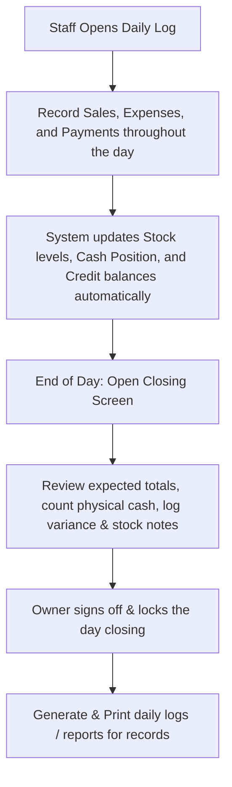

# MVP Web App Specification — Business Control

This document specifies the business workflows, data models, screen lists, and calculations for the Business Control MVP.

## 1. Business Workflow

The system provides a daily workflow to transition from paper registers to a digital control system:

## 2. Screen List

### 2.1 Login
- Simple login system for **Owner** and **Staff** roles.
- Stafford can record sales, expenses, and credit payments.
- Owner can access settings (exchange rate), run imports, view the dashboard, and close the day.

### 2.2 Dashboard
- High-level KPIs: Stock Quantity, Stock Value, Potential Sales, Estimated Gross Profit.
- Daily Tracker: Today's Sales, Today's Expenses, Expected Cash, Cash Variance.
- Credit Tracker: Outstanding Debtors and Creditors.
- Low-Stock Alerts: List of items with $\le 5$ units remaining.

### 2.3 Product / Stock Master
- Table view of all products with item numbers, costs, and selling prices in RMB and USD.
- Formula-driven pricing (default: double purchase price).
- Action buttons to add products manually or adjust stock levels (Owner only).

### 2.4 Data Import Screen
- Stepped upload flow for:
  1. Product List (`business_product_list_with_selling_prices.xlsx`)
  2. Opening Stock (`stock_tracking_workbook.xlsx`)
  3. Business Control Tracker (`business_stock_cash_credit_control_tracker.xlsx`)
- File type detection, column-header mapping, and database transaction protection.
- Live data preview showing record status (Ready, Warning, Error) before writing.

### 2.5 Daily Log (All-In-One Workspace)
- Unified panel for logging sales, expenses, debtor payments, and creditor payments during a shift.
- Day Summary panel showing live totals.

### 2.6 Daily Sales Log
- Detailed log of today's sales.
- Split-payment logic support: Cash, Credit, or Mixed (Cash + Credit).
- Enforces customer names for credit sales and prevents negative stock.

### 2.7 Daily Expenses Log
- Detailed expense records with categories (Transport, Food, Utilities, Rent, Supplies, etc.).
- Reduces expected cash in hand immediately.

### 2.8 Cash Position Tracker
- Daily cash balance sheet showing Opening Cash, inflows (sales, debtor payments, other cash in), outflows (expenses, creditor payments), Expected Closing Cash, Counted Cash, and Variance.

### 2.9 Debtors & Creditors Trackers
- Client and supplier ledgers tracking outstanding balances.
- Statuses: OPEN (no payment), PART_PAID (some payments), and PAID (fully settled).

### 2.10 Stock Ledger
- Per-product card ledger showing historical stock movements (Opening, Received, Sold, Returns, Adjustments, Closing).

### 2.11 End-of-Day Closing
- Summarized daily audit screen to enter final counted cash, input stock notes, and sign off the shift (Owner only). Locks the day to prevent tampering.

### 2.12 Exchange Rate Settings
- Manage the USD/RMB conversion rate used to map RMB costs during imports.

---

## 3. Data Model Summary (SQLite)

- **User**: Authentication accounts (Owner vs Staff).
- **ExchangeRate**: Current conversion rate.
- **Product**: Core product specifications, costs, and current stock level.
- **StockMovement**: Audit ledger of stock changes (Opening, Sale, Adjustments).
- **Sale / SaleItem**: Sales logs and line-item details.
- **Expense**: Outflow logs.
- **CashPosition**: Daily cash records.
- **Debtor / DebtorTransaction**: Credit accounts.
- **Creditor / CreditorTransaction**: Vendor/supplier liabilities.
- **DayClosing**: End-of-day audit.
- **ImportDocument / ImportRow / ImportError**: Data import logging.

---

## 4. Key Calculations

### 4.1 Pricing Formula
$$\text{Selling Price (USD/RMB)} = \text{Unit Cost (USD/RMB)} \times 2$$

### 4.2 Cash Book Formula
$$\text{Expected Closing Cash} = \text{Opening Cash} + \text{Cash Sales} + \text{Debtor Payments} + \text{Other In} - \text{Expenses} - \text{Creditor Payments}$$

### 4.3 Cash Variance Formula
$$\text{Variance} = \text{Actual Counted Cash} - \text{Expected Closing Cash}$$

### 4.4 Stock Ledger Balance Formula
$$\text{Closing Balance} = \text{Opening Balance} + \text{Received} + \text{Returns} + \text{Adjustments} - \text{Sold}$$

---

## 5. Acceptance Criteria

- Mirrors paper workflows exactly (no automated scanners, fiscal plugins, or multi-branch requirements).
- Dual RMB/USD costs tracked, USD used as the main operations currency.
- Stock movements logged automatically on sales and adjustments.
- Enforces customer names for credit sales and quantity check warnings.
- Closed days locked.
- Print layouts map to clean paper-friendly dimensions.
